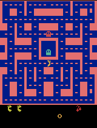
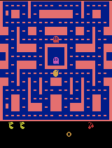
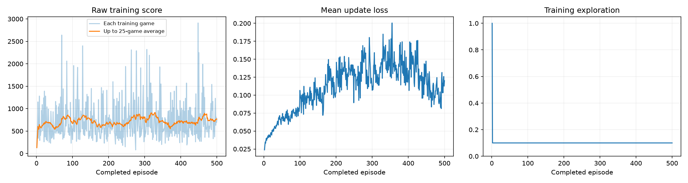

# Ms. Pac-Man DQN — Class 3 assignment

**Brian Arevalo Ramos · MBA 290T Fundamentals of Agentic AI · Class 3 / Assignment 2**

I trained the course's ready-made Deep Q-Network (DQN) on `ALE/MsPacman-v5` with three choices of my own:
**exploration 0.10, 500 training games, learning rate 0.0001.** Everything below comes from one executed run of
[`pacman_dqn.ipynb`](pacman_dqn.ipynb) on my Intel MacBook Pro (CPU). The notebook is saved **with all cell outputs**
from that final run, and the evidence it produced is copied into [`results/`](results/).

[](https://colab.research.google.com/github/BuildingBrian/pacman-dqn/blob/main/pacman_dqn.ipynb)

| | Untrained network | Trained agent |
|---|---|---|
| Mean score over the same 5 evaluation games | **{{BEFORE_MEAN}}** | **{{AFTER_MEAN}}** |
| First 20 s of one evaluation game (4× speed) |  |  |

Change in mean score: **{{DELTA_MEAN}}**. The five individual scores are in the [results table](#the-five-before-and-after-scores).

---

## 1. Open and run the notebook

**Google Colab (easiest):** click the badge above, choose *Runtime → Change runtime type → T4 GPU* if available,
edit the three values in section 1, then *Runtime → Run all*. The setup cell installs the packages.

**Local Jupyter / VS Code:**

```bash
git clone https://github.com/BuildingBrian/pacman-dqn.git
cd pacman-dqn
python3.12 -m venv .venv && source .venv/bin/activate     # Python 3.11–3.13
pip install -r requirements.txt
jupyter lab pacman_dqn.ipynb                              # then Run All
```

**Exactly how this submission was produced (headless, no browser):**

```bash
source .venv/bin/activate
python -m ipykernel install --user --name pacman-dqn
python tools/run_headless.py --deadline 20:30            # runs every cell in order, saves outputs into the notebook
python tools/collect_results.py pacman_runs/<run folder>  # copies the evidence into results/
```

`tools/run_headless.py` executes the notebook top to bottom with `nbclient` and writes the outputs back into
`pacman_dqn.ipynb`. The optional `--deadline` sends the kernel **one** interrupt at that wall-clock time if
training is still running; the notebook catches it, saves the agent as an *interrupted* run, and continues
to evaluation. {{DEADLINE_SENTENCE}}

### Changes outside section 1 (environment only, no learning settings touched)

The notebook could not run unmodified on an Intel Mac, so I made three edits that change nothing about the agent,
the fixed classroom settings, or the evaluation:

| Cell | Change | Why |
|---|---|---|
| Setup (`%pip`) | Platform-aware pins: Intel Macs get `torch==2.2.2`, `numpy<2`, `opencv-python-headless<4.12`; every other platform keeps the original pins | PyTorch stopped publishing x86_64 macOS wheels after 2.2.2, and that version needs NumPy 1.x, which in turn needs an older OpenCV. The original `torch>=2.6` pin has no installable wheel on this machine. |
| Preview settings | `SHOW_POPUPS = False` | The notebook ran headlessly; there is no desktop to open the Tk popup player on. Inline GIFs are still displayed in the notebook (the starter README documents this toggle). |
| `select_device` | Skip MPS on Intel Macs, so the run uses **CPU** | PyTorch no longer maintains the Radeon/Intel MPS path. I benchmarked both on this laptop: about 10 ms per training decision either way, so CPU costs nothing and is reproducible with the fixed seeds. |

[`requirements.txt`](requirements.txt) carries the same platform markers.

---

## 2. My three choices and why

| Setting | My value | Notebook default | Why I chose it |
|---|---|---|---|
| **Exploration** | **0.10** | 0.20 | After the 1,000-decision random warm-up, 10 % of training moves are random. This is the value the original DQN paper anneals *down to*, and it is closer to the fixed 5 % used in evaluation, so the agent trains on behavior that looks like how it will be tested. The environment already injects randomness through 25 % sticky actions and up to 30 random no-ops at reset. With a replay memory of only 5,000 decisions (roughly 5–8 games), what the network learns from is very recent, so I wanted most of that memory to be the agent's own policy rather than coin flips. The risk is the opposite failure: too little exploration can lock in an early habit. |
| **Episodes** | **500** | 100 | Five times the starting value, because the notebook itself warns that useful Atari learning "may require much longer runs". The ceiling was the calendar: the assignment was due the same night. I measured about 16 ms per training decision on this laptop, so 500 games projected to 1.5–4 hours depending on how long the agent survives (a game is capped at 3,000 decisions). I armed a one-shot safety interrupt at 8:30 PM so evaluation and this write-up would always fit before the deadline. |
| **Learning rate** | **0.0001** | 0.0001 | The reference point for Adam in DQN implementations (Stable-Baselines3 defaults to 1e-4; Dopamine uses 6.25e-5). With a tiny replay memory the gradient estimates are noisy, and a bigger step risks the divergence the notebook guards against (it aborts on a non-finite loss). A smaller step would waste the limited episode budget. |

I kept every other setting exactly as shipped: replay capacity 5,000, batch 32, warm-up 1,000, one update every
4 decisions, target sync every 1,000 decisions, gamma 0.99, seed 42, rewards clipped to [-1, 1] for learning.

**Setup check first.** Before the real run I executed the notebook once with the default settings and 5 episodes
(exploration 0.20, learning rate 0.0001). It completed 2,806 decisions and 452 learning updates in 33 seconds and
scored 492 → 408 (mean before → after), which is what a 5-game run should look like: everything works, nothing has
been learned yet. That run is not the submission; it only confirmed the pipeline.

---

## 3. What I expected before training

Written before the 500-episode run started, informed only by the 5-episode setup check:

- **Untrained baseline around 300–800 points per game** (the setup check's untrained network averaged 492). A random
  network still eats pellets because Ms. Pac-Man keeps moving in whatever direction the joystick last said, so "doing
  nothing useful" is worth a few hundred points before the ghosts arrive.
- **Modest, noisy improvement, not mastery.** I expected the trained mean to land somewhere around 600–900: the agent
  should learn that continuing along an unfinished pellet row pays, and that some moves near ghosts end the game. I did
  not expect deliberate ghost avoidance, power-pellet hunting, or clearing a maze, because 500 games is roughly
  1–2 % of the experience the original DQN paper used, and the replay memory here holds 0.5 % of the paper's.
- **A jagged training curve** with a 25-game average that drifts up slowly and can fall back, and **a loss that does not
  simply go down** (as the network's value estimates grow, the targets move with them). The notebook warns that lower
  loss is not the same as better play.
- **Real chance of no improvement or regression** on the five fixed evaluation games, because a constant 10 %
  exploration with a 5,000-decision memory can keep overwriting what was learned a few games ago.

---

## 4. What actually happened

### Training budget that was actually used

| | Value |
|---|---|
| Status | {{STATUS}} |
| Completed training games | {{COMPLETED_EPISODES}} of 500 requested |
| Agent decisions (4 game frames each) | {{TOTAL_DECISIONS}} |
| Learning updates (batches of 32) | {{LEARNING_UPDATES}} |
| Elapsed training time (including the every-25-game demos) | {{ELAPSED}} |
| Hardware | Intel Core i7-9750H (6 cores), 32 GB RAM, **CPU** (PyTorch used 4 threads) |
| Software | Python {{PYTHON}}, {{PACKAGES}} |

Source files: [`training_summary.json`](results/training_summary.json) · [`config.json`](results/config.json) ·
[`training.csv`](results/training.csv) (one row per completed game).

### The five before-and-after scores

Same five seeds (101, 202, 303, 404, 505), same 5 % evaluation exploration, same 3,000-decision cap, before and
after training. The baseline is the **untrained network**, not a random-action agent.

{{SCORE_TABLE}}

Full evaluation record with game lengths: [`comparison.json`](results/comparison.json) ·
[`baseline.json`](results/baseline.json). {{TIME_LIMIT_SENTENCE}}

### Training dashboard



{{DASHBOARD_PARAGRAPH}}

### Gameplay: untrained → every 25 games → best trained

Each GIF is the first 20 seconds of one evaluation game on seed 101 at 4× speed (about 5 s to watch), recorded by the
notebook while training continued. The score under each intermediate GIF is that checkpoint's **full** game score on
seed 101 (from [`demo_scores.json`](results/demo_scores.json)), not just the 20 seconds shown.

| Untrained (episode 0) | Best trained game (after training) |
|---|---|
|  |  |

{{INTERMEDIATE_GIF_TABLE}}

{{GAMEPLAY_PARAGRAPH}}

---

## 5. What the agent sees, does, and is rewarded for (plain language)

- **Observations — four game screens.** Each decision, the agent does not see the colorful Atari frame. It sees the last
  four screens shrunk to 84 × 84 grayscale pixels and stacked together. One screen shows *where* everything is; four in a
  row show *which way* everything is moving. That is the entire input: no maze map, no ghost coordinates, no score.
- **Actions — joystick moves.** The network outputs nine numbers, one per joystick position: no-op, up, right, left,
  down, and the four diagonals. Each number is the network's *guess* at how many future points that move leads to.
  Most of the time the agent takes the highest guess; 10 % of the time during training (5 % during evaluation) it picks
  a random move instead. One decision holds the joystick for four game frames.
- **Rewards — game points.** The game itself supplies the reward: the change in score after each decision (10 for a
  pellet, 50 for a power pellet, 200+ for a ghost, fruit bonuses). For learning, each reward is clipped to between -1 and
  +1 so a ghost is not a hundred times "louder" than a pellet; every score reported here is the raw game score. Dying is
  not punished directly; the agent only "feels" it as the future points that never arrive.
- **How it learns.** The agent stores its last 5,000 decisions and, every four decisions, replays 32 random ones,
  nudging its guesses toward *reward received + 0.99 × best guess for the next screen* (that next-screen guess comes from
  a slower-changing copy of the network so the target does not chase itself). Game over sets the future term to zero; hitting
  the 3,000-decision time cap does not.

---

## 6. One limitation I observed

{{LIMITATION_PARAGRAPH}}

## 7. Next experiment (change exactly one setting)

{{NEXT_EXPERIMENT_PARAGRAPH}}

---

## 8. Evidence index

| Evidence | Where |
|---|---|
| Executed notebook with all outputs from the final run | [`pacman_dqn.ipynb`](pacman_dqn.ipynb) |
| Settings, hardware, package versions | [`results/config.json`](results/config.json) |
| One row per completed training game | [`results/training.csv`](results/training.csv) |
| Completed episodes, decisions, learning updates, elapsed time, status | [`results/training_summary.json`](results/training_summary.json) |
| All five untrained and trained evaluation scores, game lengths, time-limit flags | [`results/comparison.json`](results/comparison.json) |
| Untrained evaluation on its own | [`results/baseline.json`](results/baseline.json) |
| Every-25-game demo scores | [`results/demo_scores.json`](results/demo_scores.json) |
| Training dashboard (score, loss, exploration) | [`results/training_dashboard.png`](results/training_dashboard.png) |
| Untrained, intermediate, and best trained GIFs | [`results/demos/`](results/demos/) |
| Headless runner and evidence collector | [`tools/`](tools/) |

**Interrupted run or no learning updates?** {{INTERRUPTED_STATEMENT}}

**Model checkpoints.** The run folder `pacman_runs/{{RUN_ID}}/` and its ZIP hold `untrained.pt`, `trained.pt`, and a
checkpoint every 25 games. They are gitignored (each is about 6.4 MB) and kept locally; {{CHECKPOINT_SENTENCE}}

---

## Sources

- Course starter repository: [pepealonso95/pacman-dqn](https://github.com/pepealonso95/pacman-dqn)
- [DQN paper: Human-level control through deep reinforcement learning](https://storage.googleapis.com/deepmind-media/dqn/DQNNaturePaper.pdf)
- [ALE installation and Gymnasium registration](https://ale.farama.org/getting-started/)
- [Gymnasium Atari preprocessing](https://gymnasium.farama.org/api/wrappers/misc_wrappers/#gymnasium.wrappers.AtariPreprocessing)
- [Gymnasium frame stacking](https://gymnasium.farama.org/api/wrappers/observation_wrappers/#gymnasium.wrappers.FrameStackObservation)
